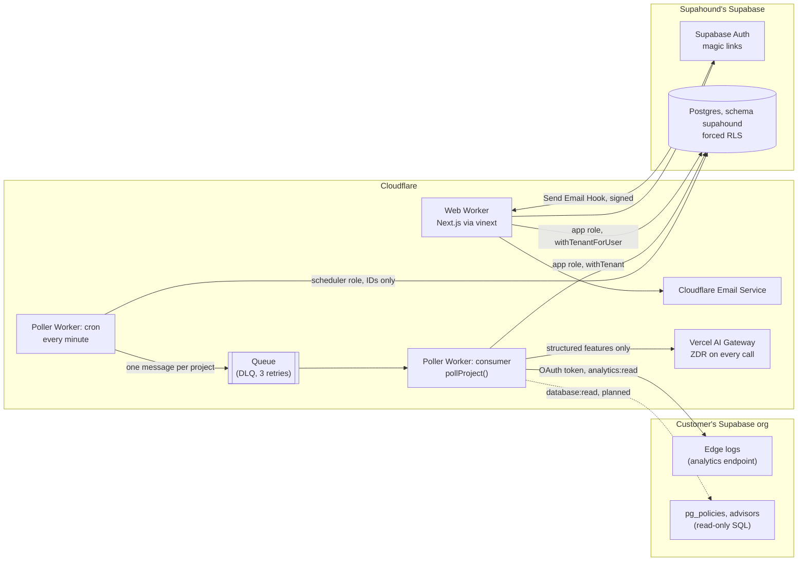

# Architecture

Updated 2026-11-09.

Supahound reads a customer's Supabase edge logs through read-only OAuth scopes. It runs
deterministic detectors on them every minute and groups findings into incidents per actor. A model
with zero data retention (ZDR) only writes the plain summary. Everything runs on Cloudflare Workers.
Supahound's own data lives in its own Supabase Postgres, reached through Hyperdrive (decision 008).

Where the PRD and a decision record disagree, the decision record wins. The PRD still names
Hetzner + Coolify, GPT-6 Luna and the slug `claude-haiku-5-5`. Decisions 008 and 011 replace all three.

## System

Both Workers reach Postgres through Hyperdrive with query caching off. Each request or queue
message creates its own `pg` pool. Workers never share I/O across requests.

## Packages

| Path | Runs on | Purpose |
| --- | --- | --- |
| `packages/core` | Node and workerd | All logic: detectors, tenancy, vault, incidents, explainer, poller, OAuth, CLI |
| `apps/poller` | Cloudflare Worker | Cron → queue → `pollProject`, through two Hyperdrive configs |
| `apps/web` | Cloudflare Worker | Next.js App Router via vinext: sign-in, onboarding, overview, Supabase connect, Send Email Hook |
| `supabase/migrations` | Postgres 17 | Schema `supahound`, roles, forced RLS |

`packages/core` exports its TypeScript source directly (`"./*": "./src/*.ts"`). The apps import it
by path, such as `@supahound/core/db/repo`. No build step sits between them.

## One poll, step by step

`packages/core/src/poller/pollProject.ts`. Transactions stay short and never span an external call.

1. **Claim.** A conditional update takes the project row lock. A second worker gets
   `claimed_elsewhere` and skips. Runs stuck in `running` for more than 10 minutes become
   `unable_to_assess` / `worker_lost`.
2. **Window.** It starts where the last `ok` run ended and ends at floor(now − 120 s) to the minute.
   The window is capped at 24 hours (`window_truncated`). Windows never overlap, so no request is
   counted twice. A log that lands more than 120 s late is missed.
3. **Token.** The vault opens the connection's sealed OAuth token. The poller refreshes it under the
   connection's row lock when it is near expiry.
   **Ownership.** On the first poll, then every 24 hours (1 hour after a failure), the poller audits
   and runs `POLICIES_SQL` on the read-only SQL endpoint and stores the owner columns (decision 024).
   A failed read keeps the last good map and never fails the poll.
4. **Audit, then query.** The SQL hash goes to `audit_log`. Then one ClickHouse query rolls the
   window up by request template (`packages/core/src/logs/sql.ts`). Supabase returns rollups, not raw rows.
5. **Detect.** Rows become `EdgeEvent`s (`logs/event.ts`; field paths only in `config/fields.ts`).
   Detector 2 checks cross-tenant access. If no ownership map has ever loaded, detector 2 does not
   run and the run lists it in `unassessed_detectors`. Detector 4 checks service-role misuse.
6. **Group.** The incident engine (`incidents/engine.ts`) groups findings per tenant + project +
   actor, in a 15-minute window. It pages on a new incident at high or above, or on an escalation to high.
7. **Explain.** `explainer/features.ts` rebuilds a whitelist of structured features and replaces
   actor IDs with aliases. `explainer/llm.ts` calls Haiku 5.5, then Grok 4.20 non-reasoning, then
   template text. The validator rejects any number or entity not in the evidence. An incident is
   explained when the engine pages it, or when it will email and is new or changed severity.
8. **Record.** The run ends as `ok` or `unable_to_assess` with an error code. A Supabase failure
   never reads as an all-clear.
9. **Email.** After the save, `sendPendingAlerts` emails each open incident at or above the
   project's threshold that has not been emailed at its severity, one email per member, and marks it
   (decision 030; `alerts/email.ts` renders it). A failed send stays pending for the next poll.

## Tenant isolation

Decision 004. Six layers, each tested:

| Layer | Where | Test |
| --- | --- | --- |
| Forced RLS on every table, keyed by `app.tenant_id` | `supabase/migrations/` | `core/test/db/isolation.test.ts` |
| `withTenant` / `withTenantForUser` are the only DB handles | `core/src/db/tenant.ts`, `user.ts` | `isolation`, `users` |
| Composite `(tenant_id, id)` foreign keys | migrations | `isolation` (mutation checks) |
| Per-tenant token keys: AES-256-GCM, HKDF, AAD bound to tenant + connection | `core/src/vault/` | `vault.test.ts`, `poller.test.ts` |
| In-memory state keyed by `scopeKey`, never by Supabase ref | `core/src/tenancy/scope.ts` | `scope.test.ts` |
| Scheduler role reads IDs only, through column grants | migrations, `poller/scheduler.ts` | `poller.test.ts` |

The web app adds a seventh: membership is checked in the same transaction that reads the data. A
non-member gets the same 404 as a missing workspace (E2E UAT-W7). An eighth works inside the tenant
(decision 036): restrictive RLS hides a project's rows from a signed-in user without a role on that
project, and refuses settings and people writes the role does not allow (`people.test.ts`, UAT-W26).
Data controls (decision 037) add restrictive policies too: only a workspace owner closes or reopens,
only owners and admins delete a connection, and no signed-in request deletes a tenant
(`dataControls.test.ts`). A purge is checked against every tenant table in the catalog: the other
tenant's row counts stay the same.

## Security of the monitor

- **Read-only by construction.** OAuth scopes only (`analytics:read`, `database:read`,
  `projects:read`; decision 023). Supahound
  never asks for the service-role key.
- **No attacker text in prompts.** User agents, emails, query values and IPs never reach a model.
  Only `llm.ts` may call a model, and ESLint blocks model imports everywhere else (`zdrGuard.test.ts`).
- **ZDR on every call** (decision 005). `providerOptions.gateway.zeroDataRetention = true` is set
  after any merge, so nothing can override it. A routing report without ZDR discards the output.
- **Web hardening.** Users come only from `getClaims()`. The middleware rejects cross-origin
  non-GET requests and sets `Cache-Control: private, no-store` on signed-in paths. The Send Email
  Hook checks its Standard Webhooks signature. The OAuth state is single-use, bound to the user and
  the workspace, and stored only as a hash.

## Data model

All tables live in schema `supahound` and carry `tenant_id`.

| Table | Holds |
| --- | --- |
| `tenants` | One Supahound account (an agency or a builder) |
| `memberships` | Supabase Auth user → tenant, with role owner / admin / member |
| `project_members` | A workspace member's role on one project: owner / admin / editor / viewer (decision 036) |
| `project_invites` | An email invite to one project: token hash, role, expiry, accepted or canceled |
| `connections` | One Supabase OAuth grant; sealed token |
| `projects` | One watched Supabase project; ownership map and when it last loaded; paused flag |
| `poll_runs` | One poll: window, status, error code, detectors it could not check |
| `findings` | Detector output: structured evidence only |
| `incidents` | Grouped findings per actor; severity, hits, summary and its source |
| `service_role_networks` | Learned server ASNs per project (decision 003) |
| `oauth_states` | Hashed OAuth state + PKCE verifier, 10-minute TTL, single use |
| `audit_log` | Every query and model call, append-only |
| `account_closures` | A closed workspace: dates, then the billing and consent record kept 7 years after the purge. No foreign key to `tenants`, so it outlives the tenant (decision 037) |

Data controls (decision 037): once a day at 00:40 UTC the poller enqueues a `data` message per
tenant. The job resolves incidents idle for 30 days, deletes incidents, findings and poll runs past
the 30-day window, and purges a workspace 30 days after its owner closed it (deleting the `tenants`
row cascades to every other row of the tenant). `supahound_notifier` is a third NOLOGIN role: it
reads owners' addresses across tenants for the subprocessor notice, and nothing else.

## Decisions

The full list is in [INDEX.md](INDEX.md). For the architecture, read 004 (isolation), 005 (ZDR),
007 (patterns, not data, across tenants) and 008 (hosting) first.
