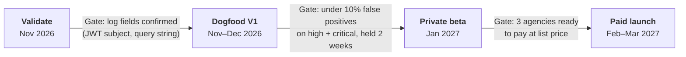

# Roadmap

Updated 2026-11-09. Source: the [PRD](https://claude.ai/artifact/Qx6AaTtA4fn6HqPJ4DcSzj),
"Milestones and next steps". Each phase is a
[GitHub milestone](https://github.com/FlywheelStudio/supahound/milestones), and each item is an issue.
No phase starts until the gate before it passes.

| Milestone | Due | Goal | Gate to leave it |
| --- | --- | --- | --- |
| [Validate](https://github.com/FlywheelStudio/supahound/milestone/1) | 2026-11-30 | Verify log fields and OAuth scopes; interview 10–15 builders and 3–5 agencies | Log fields confirmed |
| [Dogfood V1](https://github.com/FlywheelStudio/supahound/milestone/2) | 2026-12-31 | Posture scan and detectors 1–5 on Flywheel client projects | Under 10% false positives for 2 weeks |
| [Private beta](https://github.com/FlywheelStudio/supahound/milestone/3) | 2027-01-31 | 3–5 outside agencies and about 20 builders; digest and agency dashboard live | 3 agencies ready to pay |
| [Paid launch](https://github.com/FlywheelStudio/supahound/milestone/4) | 2027-03-31 | Pricing live on V1; V2 starts | — |

The [Scan funnel](https://github.com/FlywheelStudio/supahound/milestone/5) milestone (hackme.si, decision 016) is outside the PRD phases.
Its gate: legal review before any active-scan work.

## V1 scope and status

| V1 item (PRD) | Status | Issue |
| --- | --- | --- |
| Supabase OAuth connect, multi-project | Connect and project picker built; live OAuth app pending | #4, #9 |
| Posture scan | Not built | #11 |
| Detector 1: query fingerprinting | Not built | #12 |
| Detector 2: cross-tenant access | Built, 127 tests at prototype; live run pending | #3, #5 |
| Detector 3: sensitive-column writes | Not built | #13 |
| Detector 4: service-role misuse | Built; live run pending | #3, #5 |
| Detector 5: credential stuffing | Not built | #14 |
| Incident engine: per-actor scoring, dedup | Grouping and dedup built; stacked scoring not built | #15 |
| Email and signed webhook alerts | Not built | #16, #17 |
| Weekly digest | Not built | #22 |
| Basic agency dashboard | Workspace overview built; agency view not built | #23 |
| Tenant isolation, vault, poller | Built; needs Supahound's Supabase project | #8 |
| ZDR explainer | Built; live gateway call pending | #6 |
| Web sign-in and onboarding | Built; E2E UAT-W1..W10 in CI | #2 |

## V2 (Paid launch milestone)

Detectors 6–10 (#28), deploy markers (#29), log drain ingestion (#30), client report export (#31),
SMS for critical incidents (#32). The SMS add-on needs a new service, so Erik decides first.

## Non-goals

Long-term raw log storage or a general SIEM. Any write access, auto-remediation or traffic blocking.
Replacing the user's coding agent. Backends other than Supabase, for now.
